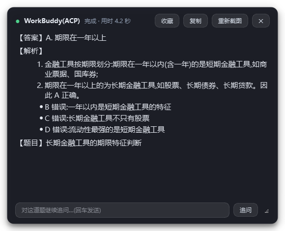
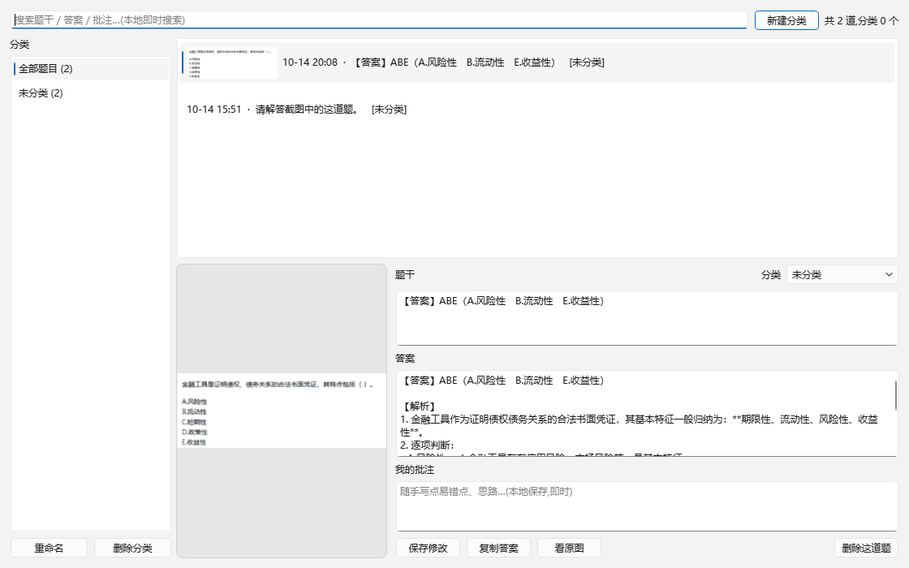
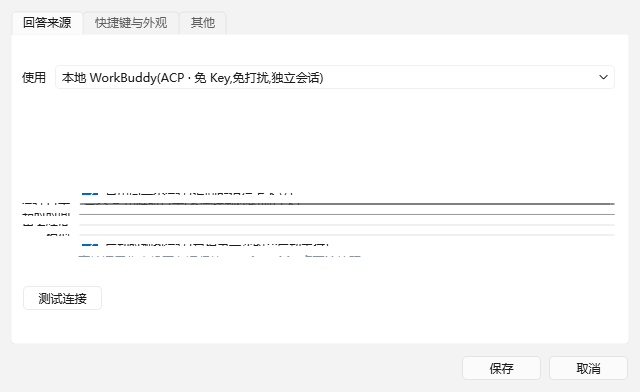

# 截图自动搜题(Screenshot QA)

Windows 桌面小工具:**点一下悬浮按钮 → 框选题目 → 答案直接出现在桌面上**。
不用截图、切窗口、粘贴、等回复。

- 🖱 **桌面悬浮按钮**:左键截图,右键菜单,可拖动、可吸边,有防误触
- 🎯 **原图直发**,不在本地 OCR,公式/表格/图形/选项排版都看得懂
- 🤖 **默认用你本机已登录的 WorkBuddy 答题**,不需要任何 API Key
  (没装 WorkBuddy 也能用:换成豆包官方 API 或你自己的接口)
- 🪟 **答案贴在桌面上**:置顶浮窗,可拖动缩放,不抢焦点,支持追问
- 📁 **收藏夹**:一键收藏、自建分类、写批注、搜索 —— 全部本地 SQLite,毫秒级



| 悬浮按钮 | 收藏夹 | 设置 |
| --- | --- | --- |
|  |  |  |

---

## 快速开始(3 步)

### 1. 环境要求

| 项目 | 要求 |
| --- | --- |
| 系统 | Windows 10 / 11 |
| Python | 3.9 或更高(安装时**勾上 `Add Python to PATH`**) |
| 答题能力 | 二选一:**① 装了 WorkBuddy 桌面端并已登录**(推荐,不用 Key)**② 或**自备一个视觉模型 API Key |

### 2. 下载并安装

**方式一(推荐,不用命令行)**:在本仓库页面点 **Code → Download ZIP**,
解压到任意目录,双击里面的 `install.bat`。

**方式二(用 git)**:

```bat
git clone https://github.com/<你的用户名>/<仓库名>.git
cd <仓库名>
install.bat
```

### 3. 启动

双击 **`run.bat`** → 右下角托盘出现图标,桌面上出现悬浮小按钮。

- 装了 WorkBuddy:确认它开着(最小化就行),直接就能用
- 没装 WorkBuddy:右键悬浮按钮 → 设置 → 回答来源改成「豆包官方 API」,
  填上 [火山方舟](https://console.volcengine.com/ark) 的 API Key

然后:**点悬浮按钮 → 框选题目 → 等答案**。

---

## macOS 也能用

代码里所有平台相关的部分(全局热键、开机自启、截图权限、窗口信息)都做了双实现,
macOS 走单独的实现路径。

> **先说实话**:我没有 Mac 真机,**macOS 这条路径没法在我这边运行验证过** ——
> 逻辑和接口都按 Apple 官方文档写,并且加了跨平台的单元测试,但真机上的表现需要你(或
> 有 Mac 的朋友)跑一次确认。有问题把终端输出发我,我照着改。

### 需要的两个系统权限

macOS 对截屏和键盘监听管得很严,第一次用一定要给这两个权限,否则会出现"截出来是壁纸"
或"热键没反应":

| 权限 | 不给会怎样 | 在哪开 |
| --- | --- | --- |
| **屏幕录制** | 截图只有桌面壁纸,或一片黑 | 系统设置 → 隐私与安全性 → **屏幕录制** → 勾上本程序(或终端) |
| **辅助功能** | 全局快捷键 `Alt+Q` 不生效(悬浮按钮仍然能用) | 系统设置 → 隐私与安全性 → **辅助功能** → 勾上本程序(或终端) |

给完权限**要重启一次程序**(macOS 只在进程启动时读取权限)。

### 安装与启动

```bash
# 安装(也可以直接在访达里双击 install.command)
bash install.command

# 启动(也可以直接双击 run.command)
bash run.command
```

> `.command` 文件如果双击没反应,右键 → 打开方式 → 终端。
> 或者手动来:`.venv/bin/python main.py`

### 和 Windows 版的差异

| 功能 | Windows | macOS |
| --- | --- | --- |
| 全局热键 | Win32 `RegisterHotKey` | `pynput`(需要辅助功能权限) |
| **单击选中整个窗口 / 鼠标悬停窗口高亮** | ✅ | ❌ **没实现**(框选截图完全不受影响) |
| 开机自启 | 注册表 `Run` | `~/Library/LaunchAgents/com.screenshotqa.plist` |
| 悬浮按钮 / 答案浮窗 / 收藏夹 / 系统托盘 | ✅ | ✅ 完全一样(纯 Qt 代码) |
| 回答来源 | 四个后端 | 四个后端都在;但默认的 **WorkBuddy(ACP) 需要 WorkBuddy 有 Mac 版** |

**如果 WorkBuddy 没有 Mac 版**:打开设置 → 回答来源 → 改成「**豆包官方 API**」,
填上火山方舟的 Key 就能用(功能完全一样)。

### 自己跑一遍自检

macOS 上也可以跑测试套件(会自动跳过 Windows 专属的用例):

```bash
.venv/bin/python tests/smoke.py
```

---

## 目录

- [一、先说 GitHub 检索结论](#一先说-github-检索结论)
- [二、快速开始](#二快速开始) / [三、怎么用](#三怎么用)
- [四、收藏夹在哪](#四收藏夹在哪三个入口) / [五、悬浮按钮](#五悬浮按钮防误触)
- [六、收藏夹](#六收藏夹分类--批注全本地) / [七、速度实测](#七速度实测出来的结论以及为什么没做-ocr)
- [八、配置文件](#八配置文件) / [九、常见问题](#九常见问题)
- [十、目录结构](#十目录结构) / [十一、实现原理](#十一本地-workbuddy-这条路是怎么实现的)
- [十二、开发与自测](#十二开发与自测)

---

## 一、先说 GitHub 检索结论

写之前按 `截图 搜题`、`截图 AI 答题 悬浮窗`、`豆包 截图 搜题` 等关键词搜过,相关项目有:

| 项目 | 技术路线 | 为什么还是自己写 |
| --- | --- | --- |
| `notxcm/AutoAnswer_ai`(40★) | 本地 RapidOCR + DeepSeek API + 悬浮窗 | 走 OCR,公式/图形题容易丢信息;接的不是豆包 |
| `baoabaob/snip-ans`(8★) | 全局快捷键截图 + AI 识题 | 轻量版,同样不是豆包 |
| `gowing111/mianmianxing`(2★) | Windows 桌面应用 | **只发安装包、不含源码**,改不了 |
| `futureYYY/TiJing`、`zezezezezly/AI_Answer_Tool` | Android 端 | 手机端,不是桌面工具 |
| `cophQ/QBankSnap` | 截图 + **本地私有题库**检索 | 只从自带题库找答案,命中不了直接说"无" |
| `xyblue135/QuarkSeleniumKit` | Selenium 驱动夸克浏览器 | 依赖浏览器自动化,页面一改就失效 |

**没有一个是"截图 → 直连本地智能体 → 答案贴在桌面"的**,所以照你的使用习惯从头写了一个。

---

## 二、快速开始

### 第 1 步:装依赖

需要 **Python 3.9 或更高版本**(安装时记得勾 `Add Python to PATH`),双击 **`install.bat`**。

### 第 2 步:选一条回答来源

双击 **`run.bat`** 启动 → 右下角托盘出现图标 → **右键图标 → 设置 → 回答来源**,三选一:

#### 方案 A:本地 WorkBuddy(ACP)—— 默认,推荐

**不需要 API Key。** 只要 WorkBuddy 桌面端开着并已登录(最小化没关系,别退出):

- 不操作窗口、不抢焦点、不动剪贴板;
- 题目截图以 **base64 原图**直接发过去(协议里 `promptCapabilities.image = true`);
- **每次答题都在新建的独立会话里**,不会污染你正在用的对话和项目;
- 答案流式回填到桌面浮窗。

> 原理见文末「本地 WorkBuddy 这条路是怎么实现的」。

#### 方案 A2:豆包官方 API

1. 打开 [火山方舟控制台](https://console.volcengine.com/ark)(豆包官方 API 平台),注册登录。
2. 左侧 **「API Key 管理」→ 新建 API Key**,复制出来(只显示一次)。
3. 左侧 **「开通管理」**,开通一个**支持图片**的豆包模型,推荐 `doubao-seed-1-6-250615`。
4. 回到设置:填 API Key、模型 ID → 点「测试连接」看到绿色成功 → 保存。

Base URL 不用改,除非你要换成别的 OpenAI 兼容服务(通义千问 VL、智谱 GLM-4V 等)。

#### 方案 B:本地智能体命令行(WorkBuddy / CodeBuddy CLI)

程序已经能自动找到 WorkBuddy 内置的 CodeBuddy CLI、按官方 `stream-json` 协议把截图作为
base64 图片块送进去、流式解析回答、识别各种失败形态。但**这个精简版 CLI 单独运行时拿不到凭据**:

- 凭据是 AES 加密存盘的(`{"$wbEncrypted":1, envelope:"...keyId/nonce/authTag/ciphertext"}`);
- 解密密钥不落盘,只有 WorkBuddy 桌面端启动这个 CLI 时才会注入;
- CLI 日志写得很明确:`route="standalone"`、`runtimeStatus="disabled"`、`missing-key role=cbc`。

所以这条路**需要一个 AUTH TOKEN**(填到设置里的「AUTH TOKEN」)。拿不到就别选它,
用方案 A(ACP)效果一样而且更干净。

> 附:如果你装的是**完整版 CodeBuddy Code**,点设置里的「登录 / 诊断」或双击
> `cli_login.bat`,等它出现自己的界面后输入 `/login` 就能登录。

#### 方案 C:自定义 HTTP 接口

如果你有自己的 agent 平台(自建服务、Dify、扣子等),把接口地址填进去即可。
程序会 POST 这样一个 JSON:

```json
{ "prompt": "请解答截图中的这道题。", "image_base64": "<PNG 的 base64>", "image_mime": "image/png" }
```

然后把返回里的文本显示到桌面窗口。字段名可以在设置里改;返回支持普通 JSON(可用
`data.answer` 这样的取值路径)和 SSE 流式两种。

### 第 3 步:用起来

按 **`Alt+Q`** → 拖动框选题目 → 松手,答案几秒后出现在桌面上。

> 想放桌面:运行 `make_shortcut.bat` 生成桌面快捷方式。
> 想开机自启:设置里勾选,或托盘右键菜单里勾。

---

## 三、怎么用

| 操作 | 效果 |
| --- | --- |
| **点桌面悬浮按钮** | 左键 = 截图搜题;按住拖动 = 挪位置(会自动吸边) |
| **右键悬浮按钮** | 弹出完整菜单(收藏夹 / 设置 / 显示答案窗 / 退出…) |
| **`Alt+Q`** | 呼出全屏截图遮罩(快捷键可改) |
| 托盘图标 **单击 / 双击** | 同上 |
| 遮罩上 **拖动鼠标** | 框选题目区域,松手立刻求解 |
| 遮罩上 **单击** | 直接选中光标下的那个窗口(会先高亮预览) |
| 遮罩上 **回车** | 确认当前高亮区域 |
| **`Esc` / 右键** | 取消截图(答案窗会原样还回来) |
| 答案窗 **拖动标题栏** | 移动位置(挪过之后就不再自动归位) |
| 答案窗 **右下角小三角** | 缩放窗口 |
| 答案窗 **双击标题栏** | 恢复默认位置(贴回题目旁边) |
| 答案窗 **底部输入框** | 对同一道题继续追问(自动带上题目和上一轮解答) |
| 答案窗 **「收藏」** | 一键存进收藏夹,可选分类(本地写入,瞬间完成) |
| 答案窗 **`Esc`** | 隐藏窗口(程序仍在托盘待命) |
| 收藏夹窗口 | 分类管理 / 搜索题干答案批注 / 改题干改批注 / 看原图 / 删题 |
| 托盘右键菜单 | 截图搜题 / 显示隐藏答案窗 / **收藏夹** / **桌面悬浮按钮** / 设置 / 历史记录 / 日志 / 开机自启 / 退出 |

贴心细节:

- 答案窗**不会抢焦点**,不会打断你在刷题软件里正在输入的答案。
- 答案是**边生成边显示**的,不用等整段回来。
- 每次的题目截图和解答都会存到 `history/日期/`。
- 截图遮罩是全屏快照做的,框选时看到的是"冻结"的那一帧,题目不会跑。

---

## 四、收藏夹在哪?(三个入口)

收藏完以后,用下面任意一种方式打开:

| 入口 | 说明 |
| --- | --- |
| **右键桌面悬浮按钮 → 📁 收藏夹** | 右键菜单第一项,最直接 |
| **右键任务栏托盘图标 → 收藏夹…** | 找不到图标就点右下角的 `^` 展开展开区 |
| **双击 `打开收藏夹.bat`** | 程序没开就顺便打开程序;已经开着就直接把收藏夹调出来 |

> 顺手加了个小便利:**程序已经在跑的时候,你再双击一次 `run.bat`,也会直接打开收藏夹**
> (以前是默默退出,现在会把这个窗口叫出来)。

收藏完的题,也可以从答案窗的「收藏」按钮菜单里点「打开收藏夹」。

## 五、悬浮按钮(防误触)

常驻桌面的小圆钮,不用再去翻任务栏:

- **左键单击** → 直接进截图
- **按住拖动** → 只移动位置,松手自动吸附到屏幕边缘
  (移动超过 6px 就判定为拖动,**绝不会**在你挪按钮的时候误触发截图)
- **右键** → 完整菜单
- 平时半透明,鼠标移上去才变清晰;位置会记住
- 截图时会先把自己藏起来,不会被拍进题目里

想要更强的防误触,可以在设置里把触发方式改成「**双击截图**」。
另外还能调按钮大小,或者干脆在托盘菜单里关掉它。

## 六、收藏夹(分类 / 批注,全本地)

答完点答案窗上的「收藏」→ 选一个分类(或新建)→ 完成。
之后按 `Alt+Q` 旁边的托盘菜单「收藏夹…」或右键悬浮按钮就能打开。

| 能做 | 怎么做 |
| --- | --- |
| 建分类 | 收藏夹窗口左上「新建分类」;收藏时也能顺手新建 |
| 归类 | 收藏时直接选;或在详情里改分类下拉框,点保存 |
| 写批注 | 详情区「我的批注」,随手写,点保存 |
| 改题干 | 题干框可直接编辑(识别错了可以自己改) |
| 找题 | 顶部搜索框,题干 / 答案 / 批注一起搜 |
| 看原图 / 删题 | 左边的大图**点一下就打开原图**;删除在右下角 |

**题目是怎么显示的**:**截图就是题干**。

- 收藏时会连**截图原图**一起存下来,收藏夹是**卡片式**浏览 ——
  每张卡片上半部分就是题目截图(横屏图按宽度撑满,不会挤在竖长框里),
  下面是时间和分类;
- 点一张卡片,右边就能改分类、写批注、改题干摘要;截图点一下用系统看图工具打开;
- 题干那一栏是模型顺手给的**文字摘要**(提示词里让它用【题目】开头输出一行),
  只用来**搜索和归档**;识别不到时会退而用答案首行 —— 不影响你看图做题。

**为什么快**:分类、批注、搜索全部走本地 SQLite(`collection/collection.db`),
截图原图存在 `collection/images/` 下,
点一下就是毫秒级 —— **大模型只负责"答题"这一件事**,整理归类不经过它。

## 七、速度:实测出来的结论(以及为什么没做 OCR)

你提的"先 OCR 再喂文字"这个思路,我**测了,但没有采用**,原因是有数据:

| 输入方式 | 首字耗时 | 总耗时 |
| --- | --- | --- |
| 1600px 大图 | 4.0s | 4.7s |
| 1600px 大图(再来一次) | 4.5s | 4.9s |
| 600px 小图 | 5.5s | 6.3s |
| **纯文字(不传图)** | **3.8s** | **4.5s** |

也就是说:**文字和图片几乎一样快,图片尺寸也几乎不影响速度**。
瓶颈不在"模型看图",而在别的地方。又做了配置对照:

| 配置 | 第 1 轮 | 第 2 轮 |
| --- | --- | --- |
| 默认(fullAccess + 默认思考) | 4.9s | 15.3s |
| 低思考强度 | 5.5s | 4.7s |
| 计划模式 | 15.0s | 9.9s |
| 短提示词 | 13.7s | 3.7s |

**同一配置来回测,3.7s ~ 15.3s 随机波动** —— 说明剩余的时间是 WorkBuddy 服务端
自己的排队/调度,ACP 这边调不动。所以最终做了这几件**确实有用**的事:

1. **启动预热**:新建会话的第一次调用要多花约 10 秒(服务端冷启动),程序启动时
   偷偷跑一次带图片的热身把它烧掉,你真正截第一题时就不用等了。
2. **不让它去调工具**:提示词明确要求直接作答。实测工具调用 **0 次** ——
   一旦它开始检索/读文件,一道题就是几十秒到几分钟。
3. **流式输出**:一边生成一边往桌面窗口里填,不用等整段回来。
4. **不用计划模式**:实测反而更慢。

设置里还能调「思考强度」和「模型」(WorkBuddy 界面里那些模型,包括 x0.21 的
「快速」和免费的「hy3」),想更省额度可以换。

## 八、配置文件

保存设置后会生成 `config.json`(结构同 `config.example.json`):

```json
{
  "backend": "workbuddy_acp",
  "workbuddy_acp": {
    "reuse_session": true,
    "cwd": "",
    "timeout_seconds": 300,
    "thought_level": "low",
    "model": "",
    "warm_up": true
  },
  "api": {
    "base_url": "https://ark.cn-beijing.volces.com/api/v3",
    "api_key": "",
    "model": "doubao-seed-1-6-250615",
    "temperature": 0.2,
    "max_tokens": 4096,
    "timeout": 180,
    "thinking": "disabled"
  },
  "floating_button": {
    "enabled": true,
    "size": 46,
    "opacity": 0.62,
    "snap_edges": true,
    "trigger": "single",
    "pos": null
  },
  "cli": {
    "command": "",
    "tools": "Read",
    "permission_mode": "",
    "extra_args": [],
    "env": {
      "CODEBUDDY_AUTH_TOKEN": "",
      "CODEBUDDY_BASE_URL": ""
    },
    "timeout_seconds": 300
  },
  "simple": {
    "url": "",
    "headers": {},
    "prompt_field": "prompt",
    "image_field": "image_base64",
    "response_path": "",
    "timeout_seconds": 180
  },
  "hotkey": "Alt+Q",
  "system_prompt": "你是一个答题助手。用户会发来一道题目(可能是选择题、填空题、判断题或解答题)的截图。\n请严格按照下面的格式回答:\n1. 第一行用【答案】开头,直接给出最终答案。选择题给出选项字母及选项内容;填空题/解答题给出关键结果。\n2. 空一行后,用【解析】开头,给出简明、分步骤的讲解,说明为什么选它、其他选项错在哪里。\n3. 若图片模糊、信息不全或含多道题,请指出,并按题号分别作答。\n请用简体中文回答,不要重复题目原文,不要输出与题目无关的内容。",
  "followup_prompt": "针对上面这道题,继续解答用户的追问:{question}",
  "appearance": {
    "opacity": 0.94,
    "font_size": 15,
    "width": 580,
    "height": 480,
    "auto_hide_seconds": 0,
    "last_pos": null
  },
  "behavior": {
    "save_history": true,
    "copy_answer_to_clipboard": false,
    "show_window_highlight": true,
    "notify_on_done": false
  },
  "autostart": false
}
```

几个关键项:

- `backend`:`openai` / `cli` / `simple`,对应上面三条路。
- `cli.tools`:默认 `Read`,只给读权限;设成 `""` 表示**禁用全部工具**(最安全,纯看图回答)。
- `cli.env.CODEBUDDY_AUTH_TOKEN`:如果你有 token,填这里就不用手动登录了。
- `api.thinking` 设 `disabled` 让豆包直接给答案,更快;想让它先推理就改成 `enabled`。
- `appearance.auto_hide_seconds` > 0 时答完 N 秒自动隐藏(鼠标移到窗口上会暂停计时)。

---

## 九、常见问题

**提示"没找到 WorkBuddy 的 ACP 网关"?**
WorkBuddy 5.8.3 起,这个本地接口不一定随开机自启就打开(实测开机后只有几个 404 端口,
没有 `/api/v1/*`)。按顺序试:

1. **打开 WorkBuddy,点进任意一个对话**,让它处于活跃状态,再点答案窗上的「重试」,
   或托盘右键 →「重新检测连接」;
2. 还不行就在设置里手动填「网关地址」(形如 `127.0.0.1:57464`,端口每次启动会变);
3. 或者把「主后端失败时」设成「自动切到 豆包 API」,并在设置里填好 Key。

**提示"没找到 WorkBuddy 的 ACP 网关"?(旧版)
把 WorkBuddy 桌面端打开(最小化就行,别退出),并确认它是登录状态。

**本地智能体说"没有可用的登录凭据"?**
这是 WorkBuddy 精简版 CLI 的限制(详见方案 B 的实测结论),不是配置问题。
要么填 `AUTH TOKEN`,要么改用「豆包官方 API」。

**输入 `/login` 报 `SyntaxError: invalid syntax`?**
你进的是 **Python** 的窗口(`>>>` 提示符),不是 CodeBuddy。
`/login` 是 CodeBuddy 的斜杠命令,Python 当然不认。
按 `Ctrl+Z` 再回车退出 Python(或者干脆改用 `cli_login.bat`,它会自己把 CLI 拉起来)。

**双击 .bat 出现"不是内部或外部命令"?**
旧版本这批 .bat 里有中文,cmd 用 GBK 解析时会乱码成命令。现在已经全部改成纯 ASCII,
不会再出现这个问题。

**找不到 CLI?**
设置里点「自动探测」。实在找不到就手动填:
`<WorkBuddy安装目录>\resources\app.asar.unpacked\cli\dist\codebuddy-lite-wb.mjs`。

**本地智能体第一次回答很慢?**
第一次要拉起 Node 进程、加载一堆模块,通常 5~15 秒;之后会快一些。

**快捷键按了没反应?**
多半被别的软件占了(比如已经开着一个本程序的实例)。设置里换一个,保存后立刻生效;
被占用时程序会在屏幕下方直接告诉你是哪个键冲突。

**提示 401 / 403 / 404 / 429?**
程序会把这些翻译成中文直接显示在答案窗:401 是 Key 不对,403 是没开通该模型,
404 是模型名写错,429 是太频繁或额度用完。

**公式显示成 `x^2` 这种源码?**
目前按纯文本 + 基础 Markdown 渲染,复杂 LaTeX 不会排成漂亮的数学格式,但内容可读。

**抓到的截图是黑屏?**
少数显卡/驱动组合下 Qt 抓屏会黑屏,程序会自动回落到 BitBlt 再抓一次。

**托盘图标在哪?**
任务栏右下角,可能被折叠了,点向上的小箭头 `^`。

---

## 十、目录结构

```
截图自动搜题/
├─ main.py                  启动入口
├─ run.bat                  日常启动(无控制台)
├─ run_debug.bat            调试启动(能看日志)
├─ install.bat              一键装依赖
├─ cli_login.bat            本地智能体登录(首次用一次)
├─ make_shortcut.bat        创建桌面快捷方式
├─ config.example.json      配置示例
├─ assets/                  图标
├─ history/                 题目截图 + 解答存档
├─ logs/app.log             运行日志
├─ screen_qa/               程序本体
│  ├─ main.py / app.py      启动与整体流程编排
│  ├─ backend.py            后端工厂(选谁来回答)
│  ├─ workbuddy_acp_backend.py  ★本地 WorkBuddy(ACP 协议,默认后端)
│  ├─ floating_button.py    ★桌面悬浮按钮(左键截图/右键菜单/防误触)
│  ├─ collection.py         ★收藏夹数据层(本地 SQLite)
│  ├─ collection_window.py  ★收藏夹界面(分类/批注/搜索)
│  ├─ api.py                豆包官方 API / OpenAI 兼容客户端(流式)
│  ├─ cli_backend.py        本地智能体 CLI(WorkBuddy / CodeBuddy)
│  ├─ simple_http_backend.py 自定义 HTTP 接口
│  ├─ hotkey.py             全局热键(Win32 RegisterHotKey)
│  ├─ overlay.py            全屏截图遮罩 / 框选 / 窗口拾取
│  ├─ capture.py            抓屏(Qt 为主,mss 兜底)
│  ├─ answer_window.py      桌面悬浮答案窗
│  ├─ settings_dialog.py    设置界面
│  ├─ markdown.py           轻量 Markdown 渲染
│  ├─ winutil.py            Win32 辅助(取窗口、单实例)
│  ├─ autostart.py          开机自启
│  ├─ toast.py              轻提示
│  ├─ errors.py             统一错误类型
│  └─ config.py             配置读写
├─ tests/
│  ├─ smoke.py              冒烟测试(116 项,不碰真实屏幕和真实接口)
│  ├─ mock_ark.py           本地假接口
│  └─ fake_agent_cli.mjs    假的本地智能体 CLI(复刻 stream-json 协议)
└─ tools/
   ├─ make_icon.py          生成图标
   └─ cli_login.py          cli_login.bat 的实际脚本
```

---

## 十一、本地 WorkBuddy 这条路是怎么实现的

WorkBuddy 桌面端内置了一个 **ACP(Agent Client Protocol)网关**,跑在本机动态端口上,
并且**对本地回环连接免鉴权**(CLI 源码里就是 `if (isLoopbackAddress(i)) return true`)。
CLI 里还内嵌了完整的 OpenAPI 文档,协议长这样:

```
POST /api/v1/acp/connect                  -> { connectionId, sessionToken }
POST /api/v1/acp  method="initialize"     Header: acp-connection-id
POST /api/v1/acp  method="session/new"    -> { sessionId, models, modes, ... }
POST /api/v1/acp  method="session/prompt" -> SSE: session/update / agent_message_chunk
```

程序做的是:动态扫出网关端口 → connect → initialize → `session/new` → 把截图作为
base64 图片内容块发进 `session/prompt` → 从 SSE 里流式收 `agent_message_chunk`。

两个关键坑(都实测踩过):

1. **会话隔离**:同一条连接上第一次 `session/new` 会贴到"你当前正在用的会话",
   第二次才真正新建。所以程序故意调两次,只用第二次的结果 —— 答题永远在独立会话里。
2. **事件串台**:ACP 的流会把**其它会话**的通知也推过来(你 WorkBuddy 里的 agent 自己也被
   这个坑过)。所以程序**严格按 sessionId 过滤**,只认自己那个会话的 chunk。

另外网关端口**每次都可能变**,不能写死,每次都要现找。

## 十二、开发与自测

```bat
run_debug.bat                                  :: 带控制台启动,日志直接打在窗口里
.venv\Scripts\python.exe tests\smoke.py        :: 跑冒烟测试
```

冒烟测试用**本地假接口 + 假 CLI + 合成图片**跑通全链路(热键通道、截图裁剪、
三种后端的请求与流式解析、答案窗渲染、追问、历史落盘、单实例、被占用时降级),
不会抓你的真实屏幕、也不会花你的额度。

---

## 十三、说明

工具是为了自己刷题时查漏补缺、搞懂不会的题,请用于日常练习和自查;别拿它去应付正式考试。